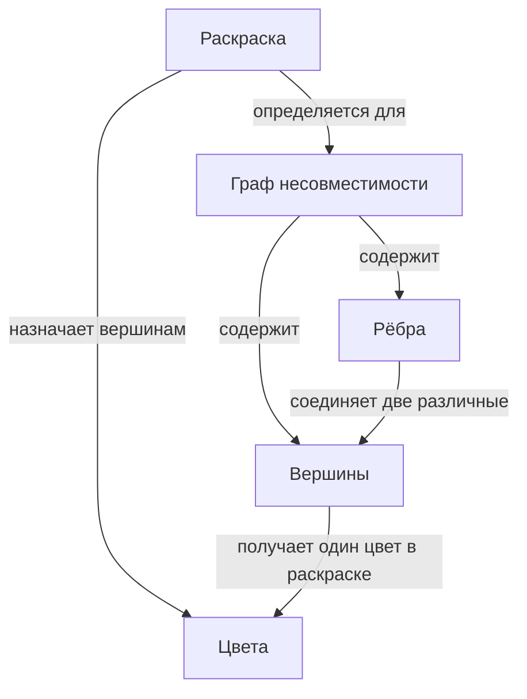
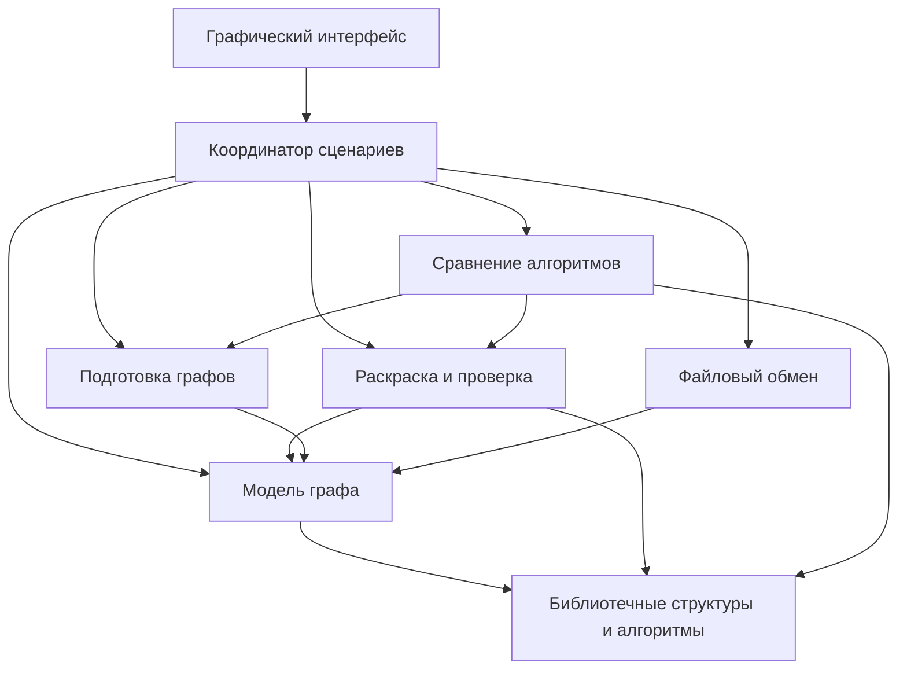

## 2. Постановка задачи

Требуется спроектировать программу для построения неориентированного графа и назначения цветов его вершинам. Две вершины, соединенные ребром, должны получать разные цвета. Программа должна позволять подготовить исходный граф вручную или автоматически, выбрать способ раскраски, изучить решение и сравнить алгоритмы на одинаковых исходных данных.

### 2.1. Выбранная конфигурация задания

Основой постановки служит задание лабораторной работы № 3 по курсу «Информатика (организация и поиск данных)». Выбирается следующий состав основной задачи:

| Пункт | Код | Рейтинг |
| --- | ---: | ---: |
| Неориентированный граф | `М-1.2` | 6 |
| Раскраска | `М-2.1` | 7 |
| **Итого** | | **13** |

Выбранный состав удовлетворяет требованию о суммарном рейтинге не менее 12. Подготовка графов, измерения и экспорт результатов предусматриваются как средства ввода данных и исследования основных алгоритмов; отдельный рейтинг за них в приведенную сумму не включается.

Предполагается сравнить две жадные эвристики: обработку вершин в исходном порядке и обработку по убыванию степени. Цель — получить правильную раскраску и исследовать влияние порядка вершин на время работы и количество использованных цветов. Гарантия минимального числа цветов в постановку не входит.

### 2.2. Прикладное назначение

Раскраска описывает распределение объектов по группам или ресурсам при наличии попарных запретов на совместное использование. Например:

- занятия можно распределять по временным интервалам, если некоторые из них нельзя проводить одновременно;
- передатчикам можно назначать разные частотные группы при наличии взаимных помех;
- несовместимые задания можно распределять по разным партиям обработки.

В таких моделях вершина представляет объект, ребро — запрет совместного назначения, цвет — одну группу или один вариант ресурса. Меньшее число цветов означает использование меньшего числа групп при соблюдении заданных запретов.

Проектируемая программа должна работать с общей графовой моделью, не привязываясь к расписанию, частотам или другой конкретной области. Она также должна служить учебным средством: показывать исходные связи, объяснять порядок обработки вершин и давать данные для проверки и сравнения алгоритмов.

### 2.3. Границы задачи

Рассматривается конечный простой неориентированный граф без весов. Допускаются несвязные графы, изолированные вершины и пустой граф. Петли и несколько ребер между одной парой вершин не допускаются. Направления связей, веса, заранее закрепленные цвета и дополнительные ограничения на группы в выбранную модель не входят.

## 3. Предметная область

### 3.1. Понятия предметной области

#### Граф несовместимости

Граф задает рассматриваемый набор объектов и попарные запреты на их совместное назначение в одну группу. Он определяется множеством вершин и множеством ребер между ними. Прикладной смысл подписи объекта не влияет на правила раскраски.

#### Вершина

Вершина представляет один объект распределения. Она должна однозначно различаться в пределах графа и может иметь поясняющую подпись. Совпадение подписей не делает две вершины одним объектом.

Соседями вершины являются вершины, непосредственно соединенные с ней ребрами. Степень вершины — количество ее соседей. Это характеристики положения вершины в графе, а не дополнительные сущности предметной области.

#### Ребро

Ребро выражает несовместимость двух различных вершин. Связь симметрична: если одному объекту запрещено использовать ту же группу, что и другому, запрет действует в обе стороны. Порядок указания концов ребра не изменяет его смысла.

Отсутствие ребра означает отсутствие именно этого попарного запрета. Оно не требует назначать вершинам одинаковые цвета.

#### Цвет

Цвет обозначает одну группу назначения. Его существенное свойство — отличие от других цветов; конкретный оттенок используется только для визуального представления. Все цвета в выбранной задаче равноправны.

#### Раскраска

Раскраска — назначение каждой вершине графа ровно одного цвета. Она является правильной, если концы каждого ребра имеют различные цвета. Для одного графа могут существовать разные правильные раскраски, в том числе с разным количеством цветов.

Перестановка обозначений цветов не меняет соблюдение запретов. Поэтому основными характеристиками решения являются правильность назначения и число различных использованных цветов.

### 3.2. Связи понятий

### 3.3. Инварианты предметных данных

1. Граф может содержать любое конечное число вершин, включая ноль.
2. Каждое ребро связывает ровно две различные вершины одного графа.
3. Между одной неупорядоченной парой вершин может существовать не более одного ребра.
4. Правильная раскраска охватывает все вершины рассматриваемого графа.
5. В одной раскраске несколько вершин могут иметь общий цвет, если между ними нет ребра.
6. Каждый используемый цвет должен быть назначен хотя бы одной вершине.
7. Изменение состава вершин или ребер требует заново установить раскраску для нового графа.

Генератор, средство измерения времени и файловое хранилище относятся к организации решения и рассматриваются далее как компоненты системы.

## 4. Дизайн решения

### 4.1. Основные принципы

1. **Разделение ответственности.** Проект предполагает разделение графовой модели, алгоритмов и пользовательских сценариев.
2. **Общие исходные данные.** Алгоритмы должны получать один и тот же исходный граф, не изменять его и возвращать сведения, достаточные для проверки и отображения результата.
3. **Безопасная замена данных.** Подготовка нового набора данных должна завершаться до замены текущего графа.
4. **Актуальность раскраски.** Последняя успешная раскраска относится только к текущему неизмененному графу.
5. **Сохранение измерений.** Результаты измерений являются отдельными сведениями об исследованном наборе и могут сохраняться для последующего просмотра и экспорта.
6. **Повторное использование библиотек.** Для основных последовательностей и сортировки следует повторно использовать библиотечные средства предыдущих лабораторных работ. Подключение этих средств не должно требовать изменения предыдущих работ или связывать прикладную логику с их пользовательскими интерфейсами.

### 4.2. Архитектура компонентов

На схеме стрелка направлена от компонента, использующего другой компонент, к используемому.

#### Графический интерфейс

Обеспечивает ввод графа и параметров операций, выбор алгоритма, просмотр связей и раскраски, показ измерений и сообщений об ошибках. Предусматривается графическое изображение небольшого графа и табличное представление вершин, их соседей, степеней, цветов и порядка обработки. Пользовательские надписи предполагаются на английском языке.

Табличное представление должно оставаться доступным и при таком размере графа, при котором рисунок теряет наглядность. Вычисления не должны препятствовать обработке действий окна; несовместимые изменения исходных данных на время операции должны быть недоступны.

#### Координатор сценариев

Организует создание, изменение, загрузку и сохранение графа, запуск раскраски и сравнения. Он должен связывать выполненные операции с текущим состоянием приложения: определять актуальность раскраски, сохранять последние успешные измерения и учитывать несохраненные изменения исходных данных.

#### Модель графа

Определяет допустимые вершины и ребра, обеспечивает получение данных вершины и ее соседей, поддерживает изменение связей и контроль ограничений простого неориентированного графа. Сведения о связях должны принадлежать графу отдельно от прикладных данных вершины. Благодаря этому одни и те же алгоритмы можно применять к вершинам с различным содержимым.

#### Подготовка графов

Создает графы заданного размера и выбранной топологии. Для случайной топологии принимает вероятность появления ребра и начальное значение генерации. Компонент должен возвращать законченный корректный граф либо сообщение об ошибке параметров.

#### Раскраска и проверка

Предоставляет оба выбранных способа раскраски с одинаковым смыслом входных и выходных данных. Результат должен содержать назначенные цвета, число использованных цветов и порядок обработки вершин. Независимая проверка должна устанавливать правильность результата без повторения логики выбора очередного цвета.

#### Сравнение алгоритмов

Выполняет измерения на текущем графе либо на подготовленной серии графов. Для каждого входного графа запускает обе эвристики, проверяет их результаты и сопоставляет время с числом цветов. Подготовка данных и проверка правильности отделяются от измеряемой работы алгоритма.

#### Файловый обмен

Обеспечивает сохранение и восстановление исходного графа в структурированном текстовом виде, а также экспорт измерений в CSV. При чтении проверяет полноту и согласованность входных данных. При записи должен сохранять ранее существовавший файл назначения, если операция не завершена успешно.

#### Библиотечная основа

Предоставляет последовательности для хранения вершин, соседей и вспомогательных данных, а также сортировку для подготовки порядка обработки и анализа измерений. Эти средства должны быть общими для графовой модели и алгоритмов и не зависеть от графического представления задачи.

### 4.3. Базовые структуры данных

Для графа выбираются списки смежности: каждой вершине соответствует последовательность ее соседей. При неориентированном ребре каждая из двух вершин должна присутствовать в списке соседей другой. При этом количество ребер учитывает каждую пару один раз.

Такое представление позволяет непосредственно просматривать соседей очередной вершины, что является основной операцией жадной раскраски. Данные вершин хранятся отдельно от связей и должны быть доступны по их обозначениям. Последовательности должны допускать увеличение размера по мере добавления данных.

Подготовка места для новых данных должна завершаться до изменения существующих вершин и связей. Отказ подготовки должен сохранять исходный граф, включая симметрию соседства и число ребер.

Для результата раскраски необходимы соответствие между вершинами и цветами, порядок обработки и общее число цветов. Для сравнения дополнительно требуются характеристики исходного графа, выбранный алгоритм, число повторов, итоговое время и сведения о проверке. Параметры автоматической подготовки следует сохранять вместе с измерениями, если граф был создан для серии экспериментов.

### 4.4. Общая жадная схема раскраски

Контракт алгоритмов и независимой проверки требует, чтобы вершины имели последовательные идентификаторы от нуля до числа вершин минус один. Для каждого такого идентификатора получение соседей должно завершаться успешно; все соседи должны принадлежать тому же диапазону. Связи симметричны, петель нет. Во время операции граф и доступные списки соседей не изменяются. Эти требования обеспечивает модель графа; для иной реализации они являются обязательными условиями применения алгоритмов.

Общий жадный проход принимает готовый порядок, содержащий каждую вершину ровно один раз. Некорректный порядок отклоняется до назначения цветов. Подготовка порядка отделена от прохода, чтобы разные эвристики могли переиспользовать схему, а новые алгоритмы — иметь собственный способ решения.

Для обоих методов предусматривается одна схема назначения цветов:

1. Установить порядок обработки всех вершин.
2. Считать все вершины первоначально нераскрашенными.
3. Для очередной вершины определить цвета уже раскрашенных соседей.
4. Назначить ей цвет с наименьшим номером, отсутствующим среди этих цветов.
5. Повторять обработку до назначения цветов всем вершинам.

Обработанная вершина получает цвет, отличный от цветов ранее обработанных соседей. Ее еще не обработанные соседи будут соблюдать то же правило позднее. Поэтому после завершения схема обеспечивает правильную раскраску каждого ребра.

Изолированная вершина получает первый доступный цвет. Пустой граф требует ноль цветов; непустой граф без ребер — один цвет. Для любой вершины число запрещенных соседями цветов не превышает ее степень, поэтому в общей оценке достаточно не более чем на один цвет больше максимальной степени графа.

Для определения занятых цветов следует использовать повторно применяемые отметки. Их обновление должно зависеть от просмотренных соседей и проверенных цветов, без полного очищения набора всех возможных цветов перед каждой вершиной.

### 4.5. Выбор порядка вершин

Доступные алгоритмы описываются единым каталогом. Каждая запись связывает идентификатор, отображаемое название и вызываемую реализацию полного алгоритма. Интерфейс пользователя и сравнение используют этот каталог; отдельные списки и ветвления выбора по виду алгоритма не предусматриваются. Добавление метода требует его реализации и записи в каталоге. Новый метод не обязан использовать общий жадный проход, но должен соблюдать общий контракт результата.

| Метод | Порядок обработки | Причина выбора |
| --- | --- | --- |
| Последовательная жадная раскраска | Исходный порядок вершин | Простой воспроизводимый способ и основа для сравнения |
| Жадная раскраска по степени | Невозрастание степени; при равенстве — исходный порядок | Попытка раньше обработать вершины с большим количеством ограничений |

Для второй эвристики выбирается сортировка кучей: она позволяет получить необходимый порядок с предсказуемой оценкой времени и использовать алгоритм из предыдущей работы. Перестановка должна относиться к порядку обработки, сохраняя исходное обозначение вершин и сам граф.

Например, пусть имеются вершины А, Б, В, Г и ребра А—В, В—Г, Г—Б. При порядке А, Б, В, Г последовательная схема использует три цвета. Порядок по степени В, Г, А, Б позволяет получить два цвета. Этот пример показывает влияние порядка, но не устанавливает общего превосходства одной эвристики: сравнение должно оценивать оба метода на каждом наборе отдельно.

### 4.6. Независимая проверка раскраски

Проверка должна устанавливать одновременно следующие свойства:

- каждой вершине исходного графа назначен ровно один допустимый цвет;
- каждое ребро соединяет вершины различных цветов;
- заявленное число цветов совпадает с числом различных использованных цветов;
- порядок обработки содержит все вершины ровно по одному разу.

Проверяемый результат должен соотноситься с тем графом, для которого он был получен. Различие назначений цветов у двух методов само по себе не является признаком ошибки: сопоставление выполняется по правильности, количеству цветов и времени.

### 4.7. Автоматическая подготовка данных

Топологии описываются единым каталогом, связывающим идентификатор, название, минимальное число вершин, применимость случайных параметров и вызываемый способ построения связей. Подготовка вершин общая; связи формируются выбранным способом. Неизвестный идентификатор отклоняется без подстановки другого способа генерации.

Поля вероятности и начального значения генерации доступны и разбираются только для топологий, использующих случайные параметры. Остальные топологии не зависят от содержимого этих полей. Проверка допустимости размера применяется и к обычной генерации, и к первому, наименьшему размеру серии; сравнение не содержит собственных правил отдельных топологий.

Предусматриваются следующие топологии:

| Топология | Правило формирования | Назначение при проверке |
| --- | --- | --- |
| Путь | Последовательное соединение соседних вершин выбранного порядка | Простой связный граф; при наличии ребер достаточно двух цветов |
| Цикл | Замыкание пути ребром между его концами | Проверка различий четного и нечетного циклов; требуется не менее трех вершин |
| Звезда | Соединение одной центральной вершины со всеми остальными | Проверка обработки вершины с большой степенью |
| Полный граф | Соединение каждой пары различных вершин | Каждой вершине требуется отдельный цвет |
| Случайный граф | Независимое решение о наличии ребра для каждой неупорядоченной пары | Исследование разных плотностей и структур связей |

Для случайного графа вероятность ребра должна лежать в диапазоне от нуля до единицы включительно. При нулевой вероятности получается граф без ребер, при единичной — полный граф. Равные параметры и начальное значение генерации должны давать одинаковый граф.

Цикл на менее чем трех вершинах отклоняется, поскольку он несовместим с выбранной моделью простого графа. Другие топологии должны корректно обрабатывать пустой граф и граф из одной вершины там, где это допускает их определение.

### 4.8. Методика сравнения

Для одного эксперимента граф фиксируется до начала измерений. Оба алгоритма должны обрабатывать тот же набор вершин с теми же обозначениями и ребрами. В исходном графе не должно происходить изменений между запусками.

Для каждого метода предусматриваются предварительный запуск и заданное пользователем количество измеряемых повторов. Итоговым временем выбирается медиана. Если повторов четное количество, она определяется как среднее двух центральных значений упорядоченного ряда измерений.

Время должно охватывать подготовку порядка вершин и само назначение цветов. Генерация графа, файловые операции, проверка правильности и обновление пользовательского представления выполняются вне измеряемого участка. У каждого полученного решения должна быть отдельно проверена правильность.

Результат сравнения должен включать:

- число вершин и ребер исследованного графа;
- выбранный метод;
- итоговое время и число повторов;
- количество использованных цветов;
- сведения об успешности проверки;
- топологию и параметры генерации, если они известны для данного эксперимента.

Для изучения зависимости от размера следует предусмотреть серию с заданными максимальным числом вершин и количеством исследуемых размеров. Размеры должны возрастать и завершаться указанным максимумом. В серии используются общая топология и заданные параметры случайной генерации; на каждом размере методы сравниваются на одном подготовленном графе. Серия не должна заменять пользовательский граф.

### 4.9. Оценки трудоемкости

Пусть число вершин равно V, число ребер — E, степень рассматриваемой вершины — d. Для выбранных решений предусматриваются следующие оценки:

| Операция или данные | Оценка |
| --- | --- |
| Хранение графа списками смежности | `O(V + E)` |
| Перечисление соседей вершины | `O(d)` |
| Последовательная жадная раскраска | `O(V + E)` |
| Подготовка порядка по степени | `O(V log V)` |
| Жадная раскраска с подготовкой порядка по степени | `O(V log V + E)` |
| Независимая проверка результата | `O(V + E)` |
| Дополнительные данные раскраски и проверки | `O(V)` |

Добавление ребра требует проверки существующих соседей и симметричного обновления связей. Удаление также включает поиск и изменение соответствующих списков. Рассмотрение всех возможных пар при подготовке случайного или полного графа требует `O(V²)` шагов; полная стоимость построения дополнительно зависит от операций добавления ребер.

### 4.10. Согласованность состояния и обработка ошибок

Текущая раскраска должна считаться производной от неизмененного графа. Успешное изменение исходных данных отменяет ее актуальность. Измерения должны сохранять характеристики исследованного набора, позволяющие отличить его от текущего графа после последующих изменений.

| Событие | Исходный граф | Текущая раскраска | Последние измерения |
| --- | --- | --- | --- |
| Успешное редактирование или замена данных | Изменяется | Сбрасывается | Сохраняются |
| Успешная раскраска | Сохраняется | Заменяется новым результатом | Сохраняются |
| Успешное сравнение | Сохраняется | Сохраняется | Заменяются новым набором |
| Сохранение графа или экспорт измерений | Сохраняется | Сохраняется | Сохраняются |
| Отмена пользователем или отклонение некорректного ввода | Сохраняется | Сохраняется | Сохраняются |

Ожидаемые отказы должны описываться единообразно: причина, относящиеся к ней исходные данные и понятная рекомендация по исправлению. К таким отказам относятся неизвестная вершина, петля, повторное или отсутствующее ребро, неверные параметры, поврежденный файл и невозможность выполнить файловую операцию. Ожидаемая ошибка не должна приводить к частично измененному графу или замене последнего успешного результата неуспешным.

Замена существующего набора данных требует подтверждения. При закрытии с несохраненными изменениями необходимо предложить сохранение, выход без сохранения или отмену закрытия. Если выполняется длительная операция, обычное закрытие должно ожидать ее завершения.

## 5. Функциональные требования

### 5.1. Работа с исходным графом

- Система должна позволять создать новый граф: начать работу с пустым набором; замену существующего графа предварительно подтвердить.
- Система должна позволять добавить вершину: создать различимую вершину с пользовательской подписью; совпадение подписей допускается.
- Система должна позволять добавить ребро: связать две существующие различные вершины; петлю, повтор и ссылку на отсутствующую вершину отклонить.
- Система должна позволять удалить ребро: удалить связь в обоих направлениях; при ее отсутствии сообщить об ошибке без изменения графа.
- Система должна позволять просмотреть граф: показать вершины, их подписи, соседей, степени и общие числа вершин и ребер; обеспечить просмотр изолированных вершин.
- Система должна позволять сгенерировать граф: принять размер, топологию и параметры случайной генерации; заменить текущий набор только после успешной подготовки.

После успешного добавления вершины, изменения ребра, создания нового графа или генерации прежняя раскраска должна быть сброшена. Неуспешное изменение не должно сбрасывать действительный результат.

### 5.2. Раскраска и просмотр решения

- Система должна позволять выбрать метод раскраски: предоставить последовательный порядок и порядок по степени на одном и том же графе.
- Система должна позволять выполнить раскраску: назначить цвет каждой вершине, определить число цветов и порядок обработки; корректно обработать пустые и несвязные графы.
- Система должна позволять проверить результат: проверить все вершины, все ребра, число цветов и полноту порядка; результат с нарушениями отклонить.
- Система должна позволять просмотреть решение: показать цвета на рисунке и в таблице, число цветов и последовательность обработки; сохранить исходные обозначения вершин.

Порядок обработки и назначенные цвета должны давать возможность вручную проследить выбор цвета для очередной вершины. Для одной и той же стратегии и одного графа результат должен воспроизводиться. Пользователю необходимо сообщать, что правильность жадной раскраски не означает минимальность числа цветов.

### 5.3. Сравнение алгоритмов

- Система должна позволять сравнить методы на текущем графе: получить время и количество цветов для обоих методов без изменения графа и текущей раскраски.
- Система должна позволять задать число повторов: принять положительное число повторов; неверное значение отклонить.
- Система должна позволять сравнить методы на серии размеров: подготовить возрастающие размеры по заданным параметрам и выполнить оба метода на каждом графе; неподходящие размеры для выбранной топологии отклонить.
- Система должна позволять просмотреть измерения: показать характеристики набора, метод, время, количество цветов и результат проверки; сохранить последние успешные данные до следующего успешного сравнения.
- Система должна позволять экспортировать измерения: записать сведения в CSV, пригодный для внешнего построения графиков; отсутствие измерений допускает файл с описанием столбцов без строк данных.

Неуспешное сравнение не должно заменять последние успешные измерения частичным набором. После изменения текущего графа ранее полученные измерения должны оставаться доступными с характеристиками того набора, на котором они были выполнены.

Все параметры сравнения должны проверяться до подготовки первого набора данных. Пользователю должны показываться только успешно проверенные результаты; общая надпись о проверке может заменять повторение одинакового признака в каждой строке. При экспорте сведения об успешной проверке сохраняются.

### 5.4. Файловые операции

- Система должна позволять сохранить исходный граф: сохранить все вершины, их подписи и связи в структурированном текстовом виде; раскраску восстанавливать отдельным запуском алгоритма.
- Система должна позволять загрузить граф: восстановить исходные данные после проверки структуры файла, полноты записей и ограничений графа; существующий набор заменить только после успеха.
- При некорректном файле система должна сообщить о причине отказа при неполных или лишних данных, недопустимых связях и неизвестном формате; текущий граф и его раскраску сохранить.
- При ошибке записи система должна сообщить о невозможности сохранить данные; ранее существовавший целевой файл и несохраненные исходные данные не терять.

Файловое представление должно позволять различать версии формата. Подписи должны сохранять пробелы, кавычки и русские символы. Переводы строк внутри одной подписи не предусматриваются.

Количества вершин и ребер, а также обозначения концов ребер должны записываться десятичными целыми без знака. Чтение должно отклонять отрицательные значения, переполнение, посторонние символы и лишние поля.

### 5.5. Поведение пользовательского интерфейса

- Система должна принимать параметры и при ошибке указывать причину отказа и способ исправления; некорректный ввод не должен повреждать текущие данные.
- Система должна позволять выполнить длительную операцию: сохранять отзывчивость окна; временно запрещать изменение используемого графа и запуск конфликтующих операций.
- Система должна позволять заменить данные или закрыть приложение: предусмотреть подтверждение замены, обработку несохраненных изменений и возможность отменить действие.
- Система должна позволять исследовать большой граф: сохранить полный табличный доступ к вершинам и соседям при ограничении рисунка; сообщить об ограничении визуализации.

Допустимые размеры данных и диапазоны параметров должны проверяться до выполнения операции и быть понятны пользователю. Ограничение на рисунок не должно подменять проверку или обработку всего графа.

Если длительную операцию не удалось запустить, интерфейс должен восстановить доступность действий и сообщить об отказе; ожидание завершения незапущенной операции недопустимо.

## 6. Проверка проектируемого решения

Проверку следует строить на известных свойствах графов и независимом контроле результата.

- **Модель графа.** Симметрию соседства, правильный учет числа ребер, независимость данных вершин от связей, добавление и удаление допустимых ребер.
- **Ограничения.** Отклонение петель, повторных ребер и ссылок на отсутствующие вершины без изменения корректного состояния.
- **Граничные случаи.** Пустой граф, одну вершину, набор изолированных вершин, несколько несвязных частей.
- **Известные решения.** При исходном порядке вдоль пути или цикла: два цвета для пути с ребрами и четного цикла, три для нечетного цикла; отдельный цвет каждой вершине полного графа.
- **Различия эвристик.** Пример, в котором порядок по степени уменьшает число цветов, и воспроизводимый порядок при равных степенях.
- **Независимость проверки.** Отклонение соседних вершин одного цвета, пропуска вершины, повтора в порядке и неверного числа цветов.
- **Генерация.** Соответствие выбранной топологии, крайние вероятности, повторение графа при одинаковых параметрах.
- **Измерения.** Полноту результатов обоих методов, неотрицательное время, одинаковые исходные данные и сохранность пользовательского графа при серии.
- **Файловые сценарии.** Сохранение и восстановление графа, поврежденные данные, ошибку записи и сохранность предыдущего состояния.

Для небольшого фиксированного числа вершин следует предусмотреть полный перебор всех простых графов и проверку правильности обеих эвристик на каждом из них. Проверка должна контролировать запреты на ребрах и обоснованную верхнюю границу числа цветов, не предполагая оптимальность жадного решения.

Ручная проверка должна быть возможна по представленным вершинам, соседям, цветам и порядку обработки. Автоматические проверки основных алгоритмов и структуры графа должны выполняться независимо от графического интерфейса. Для исследования производительности следует использовать серию размеров и экспортировать данные, сохраняя одинаковую методику для обоих методов.
