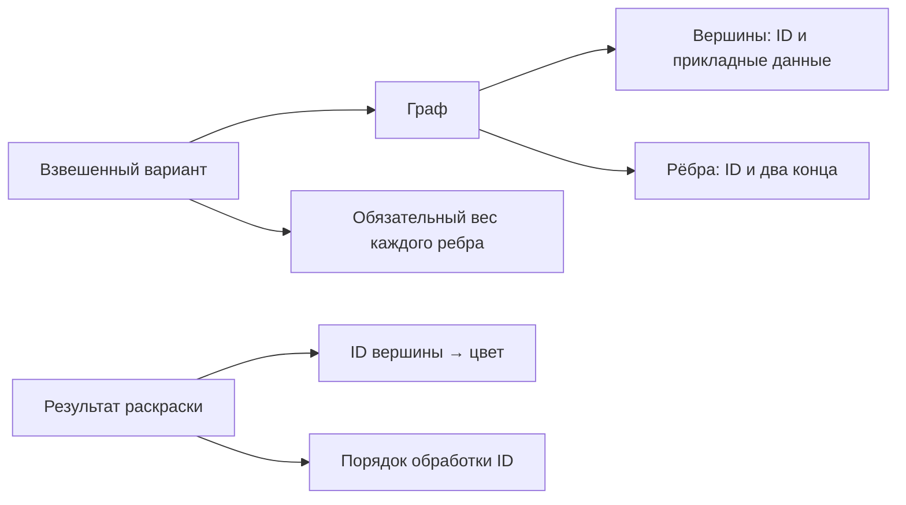

# Проектные решения

## 2. Постановка задачи

Приложение строит простой неориентированный граф несовместимости и назначает цвета его вершинам. Концы каждого ребра должны иметь разные цвета. Пользователь подготавливает граф вручную или генератором, выбирает алгоритм, изучает результат и сравнивает методы на одинаковых данных.

| Основная задача | Код | Рейтинг |
| --- | --- | ---: |
| Неориентированный граф | М-1.2 | 6 |
| Раскраска | М-2.1 | 7 |
| Итого | | 13 |

Подготовка данных, измерения и экспорт поддерживают исследование основной задачи. Используются две детерминированные жадные эвристики: последовательная и по убыванию степени. Минимальное число цветов не гарантируется.

Общая модель поддерживает невзвешенные и взвешенные графы. Приложение раскраски работает с невзвешенным вариантом. Редактор взвешенных графов, ориентированные графы и мультиграфы в задачу не входят.

## 3. Предметная область

Вершина — объект с постоянным идентификатором и прикладными данными, в приложении — подписью. Ребро имеет собственный постоянный идентификатор и соединяет две существующие вершины. Связи принадлежат графу. Взвешенное ребро дополнительно имеет ровно один обязательный вес; допустимый тип веса определяется потребителем, а не правилами арифметики графа.

Цвет — номер группы совместимых вершин. Раскраска — отдельный результат алгоритма, однозначно сопоставляющий существующие идентификаторы с цветами. Порядок обработки также относится к результату, а не к вершине или исходному графу.

### Инварианты

- Каждый ID однозначно определяет существующий элемент; позиция в рабочем представлении не является ID.
- Удаление не изменяет ID оставшихся вершин и рёбер.
- Петли и параллельные рёбра запрещены. Каждая связь симметрична.
- У каждого ребра существуют оба конца; удаление вершины удаляет все её связи и их веса.
- У взвешенного ребра всегда есть вес. У невзвешенного графа весов нет.
- Чтение модели не позволяет менять ID, концы рёбер и связи в обход операций графа.
- Ожидаемый отказ сохраняет граф и ранее вычисленные прикладные результаты.

### Жизненный цикл идентификаторов

Автоматические ID возрастают и не переиспользуются после удаления или очистки экземпляра. Максимальное представимое значение допустимо один раз; следующий запрос завершается отказом, без перехода к нулю. Импорт ID допускает только движение вперёд, поэтому ранее пропущенные значения тоже не возвращаются в обращение.

Перемещение переносит содержимое и его ID. Источник остаётся пустым и сохраняет границы уже выданных ID для повторного использования. При перемещающем присваивании получатель сохраняет максимум собственных и входящих границ. ID переносимого содержимого принадлежат пространству исходного графа; уникальность между разными экземплярами не требуется.

Файловый обмен сохраняет существующие ID и границы выдачи, включая удалённый последний элемент и исчерпанное пространство. Чтение и запись используют один актуальный формат; обратная совместимость с прежним форматом не предусматривается.

## 4. Архитектура и обоснование

### Разделение ответственности

Общая структура неориентированного графа управляет вершинами, рёбрами, связями, разрешением ID, проверками, удалением и очисткой. Невзвешенный и взвешенный варианты независимо расширяют это основание. Невзвешенный вариант не моделируется фиктивным весом или переключателем режима.

Общий публичный интерфейс содержит безопасные операции чтения, добавление вершин и удаления. Добавление структурного ребра доступно только конкретным вариантам: для взвешенного варианта обязателен вес. Расширение удаления позволяет убрать дополнительные данные ребра без дублирования общего алгоритма. Уничтожение через общий интерфейс корректно; прочие операции не требуют повсеместной динамической диспетчеризации.

Пользовательский интерфейс отвечает за ввод и представление. Прикладной координатор управляет графом, последней раскраской, признаком изменений и последними измерениями. Генерация, алгоритмы, проверка результата, файловое хранение и измерения остаются отдельными компонентами.

### Выбор библиотечной основы

Предыдущие лабораторные подключаются из GitHub на фиксированных версиях и не изменяются. Для разрешения ID выбран контракт словаря ЛР-2 и начальная реализация на сортированном массиве: поиск предсказуемо логарифмический и не вырождается на возрастающих ID. Цена этого решения — линейное удаление записи словаря и возможная линейная вставка в общем случае. Новые ID в данном проекте добавляются в возрастающем порядке.

Владение данными основано на значениях и умных указателях. Собственные пространства имён, STL-коллекции, пары, кортежи и атомарные переменные не добавляются. Имена ошибок проекта отделены от глобальных имён зависимости; ошибка зависимости переводится на границе обращения к ней.

### Воспроизводимость и расширение

Вершины и рёбра перечисляются по возрастанию ID независимо от истории удаления и внутреннего переупорядочивания. Последовательная стратегия использует этот порядок. Стратегия по степени сортирует вершины по убыванию степени, затем по возрастанию ID. Порядок соседей не определяет выбор цвета.

Каталоги алгоритмов и топологий сохраняются. Каждый каталог связывает идентификатор, пользовательское имя и вызываемую реализацию. Добавление стратегии не требует проверки конкретного класса графа или его взвешенности: раскраска пользуется общими операциями чтения.

### Раскраска и независимая проверка

Общий жадный проход принимает перестановку всех существующих ID. Он выбирает минимальный цвет, отсутствующий у уже раскрашенных соседей. Временные позиции рабочих данных отделены от постоянных ID. Пометки использованных цветов позволяют не очищать отдельный набор для каждой вершины.

Проверка независимо контролирует точное множество ID результата, полноту и уникальность порядка, диапазон цветов, использование каждого заявленного цвета и различие цветов всех соседей. Проверка не доказывает оптимальность раскраски.

### Генерация и измерения

Поддерживаются путь, цикл, звезда, полный и случайный граф. Цикл требует хотя бы трёх вершин. Случайный граф определяется размером, вероятностью и seed; прямое преобразование результатов генератора обеспечивает воспроизводимость.

Сравнение выполняет прогрев, затем заданное число запусков и вычисляет медиану. Время включает подготовку порядка, память результата и саму раскраску. Независимая проверка выполняется вне измеряемого участка. Серия размеров строит отдельные графы и не заменяет пользовательский. В CSV публикуются только проверенные результаты с размерами, методом, временем, количеством цветов и параметрами генерации.

### Оценки трудоёмкости

Здесь V — число существующих вершин, E — число рёбер, d(u) — степень вершины. Для пустых структур логарифмические оценки понимаются как `log(n + 1)`. Стоимость обработки прикладных данных и самого веса учитывается отдельно.

| Операция | Оценка выбранного решения |
| --- | --- |
| Поиск вершины, её степени или списка соседей по ID | O(log V) |
| Поиск ребра или веса по ID | O(log E) |
| Перебор соседей u с разрешением ID | O(log V + d(u)) |
| Проверка ребра между u и v | O(log V + d(u)) |
| Перечисление ID вершин / рёбер | O(V) / O(E) |
| Добавление вершины с возрастающим ID | Амортизированно O(log V), отдельное расширение O(V) |
| Добавление ребра | Амортизированно O(log V + log E + d(u)) |
| Удаление ребра u–v | O(E + d(u) + d(v) + log V) |
| Удаление вершины u | O(V + d(u)·(E + d(u) + log V) + Σ d(v)), сумма по её соседям до удаления |
| Последовательная раскраска | O((V + E) log(V + 1)) |
| Раскраска по степени, включая сортировку | O((V + E) log(V + 1)) |
| Независимая проверка раскраски | O((V + E) log(V + 1)) |
| Дополнительная память раскраски / проверки | O(V) |

Поиск ID добавляет стоимость к обходу графа, поэтому линейная оценка раскраски здесь не применяется. Линейная составляющая удаления ребра вызвана выбранными словарями, даже при быстром уплотнении основного хранилища. Логическая память графа — O(V + E); резерв ёмкости после удалений может сохраняться до очистки, поэтому физическая память зависит и от прежних размеров.

Путь и цикл строятся за O(V log(V + 1)), звезда — за O(V² + V log(V + 1)), полный граф — за O(V³ + V² log(V + 1)). Случайный граф рассматривает O(V²) пар; итоговая стоимость включает проверки и добавления выбранных рёбер. Запись файла требует O(V log(V + 1) + E log(E + 1)) без учёта длины подписей и вывода.

### Согласованность и отказы

Ошибки ввода, отсутствующие элементы, петли и повторы не изменяют модель. Подготовка памяти предшествует фиксации связи. Взвешенное добавление рассматривается как единая операция: при отказе структурной части подготовленный вес удаляется. Требования безопасного перемещения прикладных данных обоснованы контейнерами предыдущих лабораторных.

Раскраска сбрасывается только после успешного изменения графа. Неудачная генерация или загрузка сохраняет прежнее содержимое. Сохранение использует временный файл и заменяет готовый файл только после успешной записи и закрытия. Гарантия сохранности при обычном отказе не означает принудительной синхронизации с физическим носителем.

## 5. Пользовательские сценарии

Пользователь может добавить вершину, удалить её вместе со всеми связями, добавить или удалить ребро, очистить граф, сгенерировать топологию, сохранить и загрузить данные. После удаления в отображаемых ID возможны промежутки; оставшиеся вершины не перенумеровываются.

Рисунок и таблица показывают существующие ID. Таблица содержит подпись, степень, соседей, цвет и шаг обработки. Рисунок ограничен 200 вершинами, таблица доступна и для больших графов. Генерация ограничена 2000 вершинами; общий прикладной предел — 100000 вершин и 2000000 рёбер. Модель графа не содержит этих пользовательских лимитов.

Длительные вычисления выполняются в рабочем потоке. Пока задача активна, изменение графа и доступ представлений к изменяемым данным блокируются. Закрытие откладывается до окончания задачи. Несохранённые изменения можно сохранить перед выходом. Последние измерения остаются доступными после редактирования графа и описывают собственный набор исходных данных.

## 6. Проверка решения и границы

Автоматически проверяются структурные инварианты, удаление изолированных и связанных вершин, стабильность ID, уплотнение, симметрия, веса и их время жизни, отказ операций, очистка, переполнение и перемещение. Раскраска проверяется на известных топологиях, всех простых графах с пятью вершинами и графах с пропусками ID. Файловые проверки охватывают актуальный формат, отказ для неподдерживаемых заголовков, историю ID, повреждённые записи, сохранность целевого файла и прикладные сценарии.

Дополнительно выполняются сборка GUI и тестов, запуск тестов и проверка памяти с санитайзерами. Автоматические проверки ядра не заменяют интерактивную проверку компоновки GUI. Граф и прикладной координатор не обещают произвольного конкурентного доступа; отмена выполняющегося алгоритма не предусмотрена.
